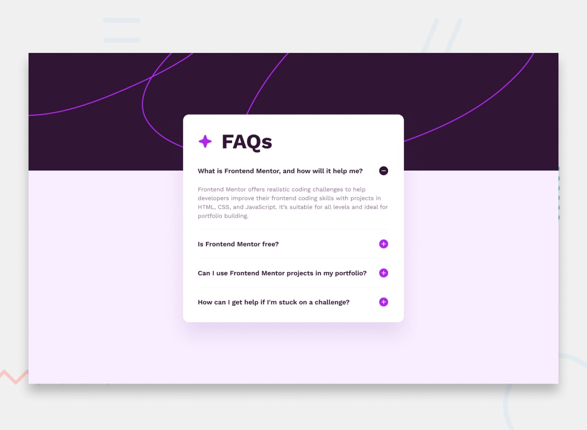
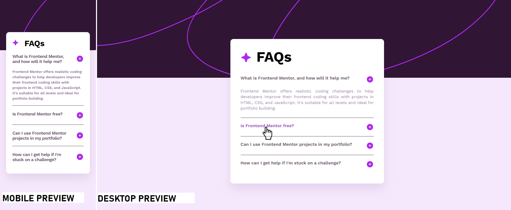

# Frontend Mentor - FAQ accordion



This is my solution to the [FAQ accordion challenge on Frontend Mentor](https://www.frontendmentor.io/challenges/faq-accordion-wyfFdeBwBz), built with HTML, CSS, and vanilla JavaScript.

## Table of contents

- [Overview](#overview)
  - [The challenge](#the-challenge)
  - [Screenshot](#screenshot)
  - [Links](#links)
- [My process](#my-process)
  - [Built with](#built-with)
  - [What I learned](#what-i-learned)
  - [Challenges](#challenges)
  - [Continued development](#continued-development)
- [Contributing](#contributing)
- [Author](#author)

## Overview

### The challenge

Build an FAQ accordion that follows the supplied mobile and desktop designs. Users should be able to:

- Open and close each answer independently.
- Navigate questions with Tab and Shift+Tab, then toggle answers with Enter or Space.
- Read the content on different screen sizes.
- See clear hover and keyboard focus states.

### Screenshot



### Links

- Source: [GitHub repository](https://github.com/pettik/FrontendMentor--faq-accordion/)
- Live site: [FAQ accordion](https://pettik-faq-accordion.netlify.app/)

## My process

### Built with

- Semantic HTML with headings, native buttons, and labelled answer panels.
- CSS custom properties, Flexbox, logical properties, and responsive `min()` sizing.
- A mobile-first layout with `rem` sizing and an `em` media query.
- Vanilla JavaScript with DOM event listeners and attribute updates.
- Work Sans typography and SVG icons and backgrounds.

### What I learned

This project reinforced how HTML, CSS, and JavaScript work together in an accessible accordion:

- Native buttons already support Enter and Space, so a click handler also handles keyboard activation without duplicate key handlers.
- Panel visibility, `aria-expanded`, `aria-hidden`, and the plus/minus icon must stay synchronized after every toggle.
- Relative units let typography and layout respond to user font preferences, while `prefers-reduced-motion` disables the color transition when requested.

The panel's `hidden` property is the source of truth when toggling an answer:

```js
const nextExpanded = panel.hidden;

panel.hidden = !nextExpanded;
panel.setAttribute("aria-hidden", String(!nextExpanded));
button.setAttribute("aria-expanded", String(nextExpanded));
```

### Challenges

- **Consistent interaction state:** The earlier implementation mixed an `open` class with `hidden`; using only `hidden` for visibility removed competing rules and the need for `height: 100%`.
- **Responsive layout:** The card overlaps a decorative background and needs room for wrapped questions; relative spacing and a constrained card width adapt the layout across mobile and desktop screens.
- **Predictable CSS:** Overlapping icon rules made overrides harder to follow; a single icon rule and simpler selectors keep sizing consistent.

### Continued development

- Add browser tests for mouse and keyboard toggling, independent panels, and synchronized accessibility attributes.
- Expand manual checks with screen readers, larger default fonts, reduced motion, and narrow viewports.
- Compare the layout against the supplied designs at more intermediate viewport sizes.

## Contributing

See [CONTRIBUTING.md](./CONTRIBUTING.md) for guidance on grouping related changes, checking them, and writing descriptive commit messages.

## Author

- GitHub - [Petr Bednarski](https://github.com/pettik)
- Frontend Mentor - [@pettik](https://www.frontendmentor.io/profile/pettik)
